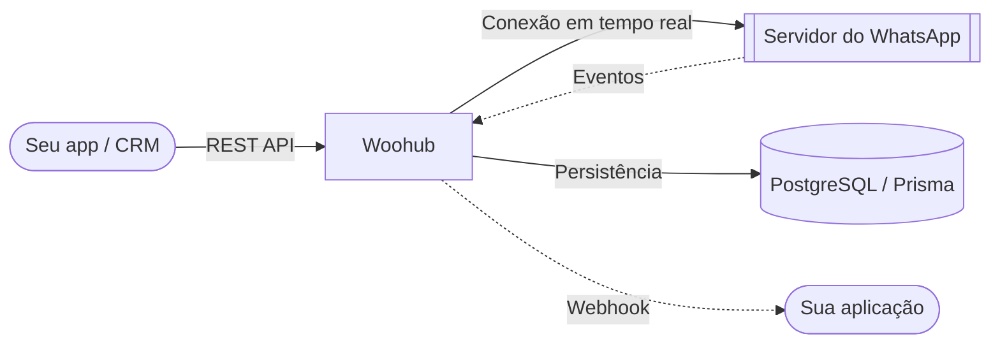

<div align="center">

# 🚀 Woohub — API de WhatsApp para negócios

[](https://wa.me/)
[](https://nextjs.org/)
[](https://www.typescriptlang.org/)
[](https://www.prisma.io/)
[](docs/README.md)

**A Woohub conecta os números da sua empresa à uma API de WhatsApp completa:**
**sessões multi-número, envio de mensagens e mídia, broadcast, autoresposta, agendamento, webhooks e painel — tudo em português.**

[Por que a Woohub](#-por-que-a-woohub) • [Recursos](#-recursos-principais) • [Referência da API](#-referência-da-api) • [Documentação](#-documentação) • [Deploy](#-auto-hospedagem)

</div>

---

## 📖 Documentação

Toda a documentação da Woohub está em português do Brasil:

- **[Guia do usuário](docs/USER_GUIDE.md)**: painel, sessões e recursos do dia a dia.
- **[Documentação da API](docs/API_DOCUMENTATION.md)**: referência completa com **mais de 100 endpoints**.
- **[Referência rápida da API](docs/API-QUICK-REFERENCE.md)**: exemplos prontos de cURL e JavaScript/Python.
- **[Arquitetura do projeto](docs/PROJECT_DOCUMENTATION.md)**: estrutura, modelos de dados e fluxos.
- **[Variáveis de ambiente](docs/ENVIRONMENT_VARIABLES.md)**: configuração e segurança.
- **[Banco de dados](docs/DATABASE_SETUP.md)**: preparação do PostgreSQL.
- **[Guia de deploy](docs/DEPLOY.md)** e **[Backup e restauração](docs/BACKUP_RECOVERY.md)**.

---

## 🌟 Por que a Woohub?

A Woohub transforma o WhatsApp da sua empresa em uma API programável: sua aplicação, CRM ou chatbot fala com a Woohub por REST, e a Woohub cuida da conexão, das sessões, da entrega e dos eventos em tempo real.

> ℹ️ A Woohub se comunica com o WhatsApp por conexão própria de dispositivo (API não oficial). Não somos afiliados ao WhatsApp nem à Meta, e não garantimos proteção contra bloqueios de conta — use as boas práticas de envio e respeite os limites do seu plano.

### 🏗️ Como funciona



### 🔥 Recursos principais

- **📱 Multi-sessão**: conecte e gerencie vários números do WhatsApp simultaneamente, com pareamento por QR Code.
- **⚡ API REST completa**: envio de texto, mídia, áudio, vídeos, documentos, stickers, localização, enquetes e respostas citadas.
- **📅 Agendamento de mensagens**: planejamento preciso com suporte a mídia (imagens, vídeos, documentos).
- **📢 Broadcast seguro**: processamento em lotes com atrasos aleatórios para campanhas de grande volume.
- **🤖 Autoresposta inteligente**: correspondência por palavras-chave com contexto (grupo/privado/todos) e anexos de mídia.
- **🛡️ Controle de acesso granular**: listas de permitidos e bloqueados para comandos e autorespostas; API keys com escopos por recurso.
- **🔗 Webhooks em tempo real**: encaminhamento confiável de eventos de mensagens, conexão, status e grupos, com assinatura HMAC.
- **🏢 Multi-empresa (tenancy)**: cada empresa com seus números, usuários, chaves, planos e cotas.
- **💳 Planos e assinaturas**: cotas de uso, cobrança e painel de faturamento por empresa.
- **📘 OpenAPI**: especificação pública em pt-BR disponível em `GET /api/v1/openapi.json` e Swagger UI interativo em `/docs`.

<details>
<summary>📂 <b>Exemplo de payload de webhook</b></summary>

```json
{
  "event": "message.received",
  "sessionId": "xgj7d9",
  "timestamp": "2026-01-17T05:33:08.545Z",
  "data": {
    "key": { "remoteJid": "6287748687946@s.whatsapp.net", "fromMe": false, "id": "3EB0B78..." },
    "from": "6287748687946@s.whatsapp.net",
    "sender": "100429287395370@lid",
    "remoteJidAlt": "100429287395370@lid",
    "type": "TEXT",
    "content": "Olá, gostaria de mais informações",
    "isGroup": false,
    "quoted": {
      "type": "IMAGE",
      "caption": "Imagem citada na resposta",
      "fileUrl": "/media/xgj7d9-A54FD0B6F..."
    }
  }
}
```
</details>

---

## 🚀 Começando

### Pré-requisitos

- Node.js 20+ (recomendado 22)
- PostgreSQL 14+ (instância externa — Supabase, Neon ou local)
- Docker + Docker Compose (caminho recomendado de deploy)

### Instalação (desenvolvimento)

```bash
npm install

# Configure o ambiente
cp .env.example .env
# Preencha DATABASE_URL, AUTH_SECRET, CREDENTIALS_ENCRYPTION_KEY, PORT etc.

# Sincronize o schema e gere o Prisma Client
npm run db:push

# Crie a conta de administrador
npm run make-admin admin@example.com senha123

# Suba o servidor
npm run dev
```

### Produção

O guia completo (imagem, Compose, Swarm, proxy reverso e verificação pós-deploy) está em **[docs/DEPLOY.md](docs/DEPLOY.md)**:

```bash
docker compose up -d
```

---

## 📚 Referência da API

A Woohub expõe uma API REST para integrar mensagens do WhatsApp diretamente na sua aplicação. Detalhes completos em **[docs/API_DOCUMENTATION.md](docs/API_DOCUMENTATION.md)**.

> [!TIP]
> Use a **Swagger UI** interativa em `/docs` ou a especificação OpenAPI em `/api/v1/openapi.json`.

| Método | Endpoint | Descrição |
| :--- | :--- | :--- |
| `POST` | `/api/messages/{sessionId}/{jid}/send` | Enviar texto, mídia ou stickers |
| `POST` | `/api/messages/{sessionId}/broadcast` | Disparo em massa |
| `PATCH` | `/api/sessions/{id}/settings` | Atualizar configurações da sessão |
| `GET` | `/api/groups/{sessionId}` | Listar grupos disponíveis |
| `POST` | `/api/webhooks/{sessionId}` | Registrar listeners de eventos |
| `POST` | `/api/autoreplies/{sessionId}` | Criar autorespostas com contexto |
| `POST` | `/api/v1/instances` | Criar instância na API versionada |

### Exemplo: enviar mensagem de texto

```bash
curl -X POST http://localhost:3000/api/messages/session_01/62812345678@s.whatsapp.net/send \
  -H "X-API-Key: sua_api_key" \
  -H "Content-Type: application/json" \
  -d '{
    "message": { "text": "Olá da Woohub!" }
  }'
```

---

## 🔐 Segurança

- **API Key**: endpoints protegidos pelo header `X-API-Key`, com escopos por recurso (`instances:send`, `messages:send`, `webhooks:write`…).
- **Multi-empresa**: isolamento por tenant em todas as consultas; chave de cliente nunca alcança rotas administrativas.
- **RBAC**: papéis `OWNER`, `ADMIN`, `STAFF`, `BILLING` (e `SUPERADMIN` auditado).
- **Senhas**: hash com bcrypt; tokens de sessão JWT assinados com `AUTH_SECRET` (obrigatório — sem fallback).
- **Credenciais de sessão**: criptografadas em repouso (AES-256-GCM).
- **Webhooks**: assinatura HMAC-SHA256 para verificação no receptor.
- **Validação de entrada**: schemas Zod nos endpoints críticos.
- **Mídia**: prevenção de path traversal e acesso escopado por sessão.
- **Rate limit**: 429 na borda da API com envelope de erro padronizado.

---

## ⚠️ Problemas conhecidos

> [!WARNING]
> **Atualização de status (POST `/api/status/update`)**
>
> O recurso de status/story do WhatsApp está com **problemas conhecidos** e deve ser evitado em produção:
> - Status de texto com cores de fundo próprias podem não exibir corretamente.
> - Status de mídia (imagens/vídeos) podem falhar no upload.
> - O recurso está em desenvolvimento ativo.
>
> Recomendamos aguardar a próxima versão antes de usar esse endpoint em fluxos críticos.

---

<div align="center">
  <b>Woohub</b> — API de WhatsApp para negócios<br/>
  Documentação em português do Brasil · Licença <a href="LICENSE">MIT</a>
</div>
